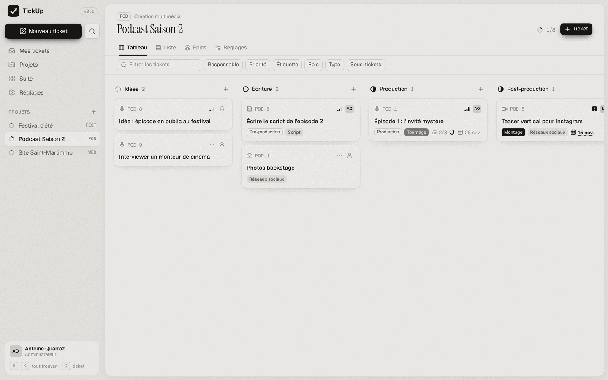
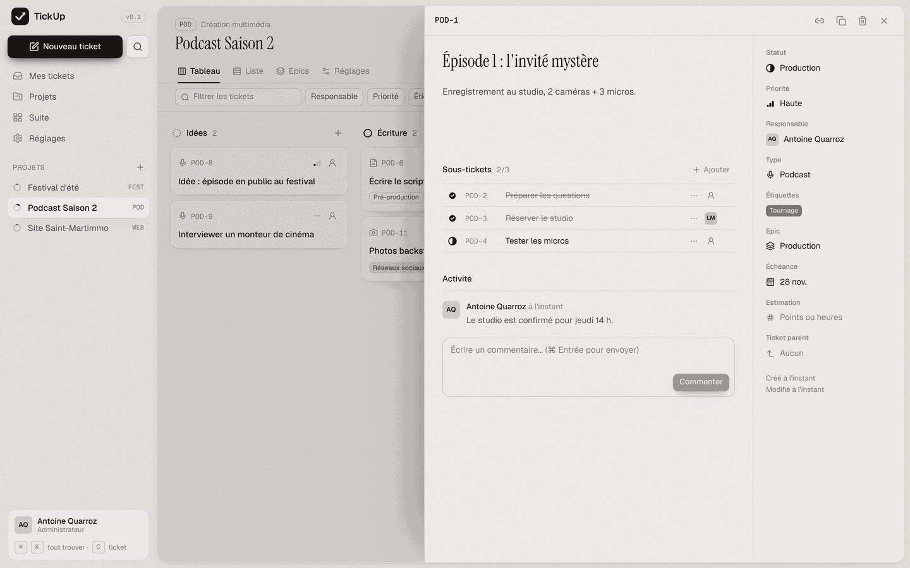
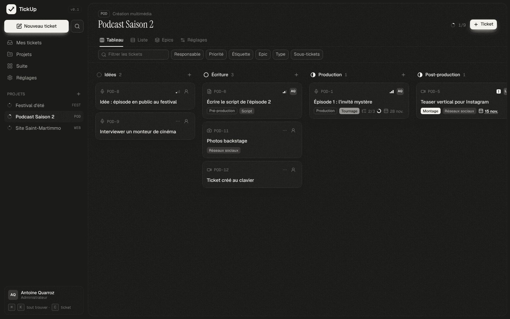

# TickUp

La gestion de projet de la suite. Projets, epics, tickets et sous-tickets, en kanban ou en liste : de quoi remplacer Linear, pour une vidéo comme pour du code.

TickUp fait partie de la même suite que [Cordée](https://github.com/antoinequarroz/maya-teams) (messagerie, la base), [Cairn](https://github.com/antoinequarroz/Cairn) (notes et coffre), [Metricove](https://github.com/antoinequarroz/metricove_v2) (réseaux sociaux) et [Alfred](https://github.com/antoinequarroz/Alfred) (calendrier) : même stack, même design, une autre couleur. Ici, le noir et blanc.





## Ce qui marche aujourd'hui

- **Trois styles de projet** : général, création multimédia, développement informatique. Chacun arrive avec ses statuts, ses types de tickets, ses étiquettes (et ses epics de départ pour le multimédia). Tout reste modifiable ensuite.
- **Tableau kanban** : une colonne par statut, glisser-déposer entre colonnes et dans une colonne.
- **Liste** : tous les tickets groupés par statut, avec les sous-tickets sous leur parent.
- **Tickets** : type, statut, priorité, responsable, étiquettes, epic, échéance, estimation, description, commentaires. Numérotés par projet (`WEB-12`).
- **Sous-tickets** : sur autant de niveaux que voulu, avec l'avancement sur le parent.
- **Epics** : les grands chantiers, avec dates de début et cible, état et avancement.
- **Filtres** : texte, responsable, priorité, étiquette, epic, type.
- **Mes tickets** : ce qui m'est attribué, tous projets confondus.
- **Réglages par projet** : statuts (nom, catégorie, ordre), étiquettes (cinq teintes du gris au noir), types et icônes, archivage.
- **En direct** : un changement fait ailleurs s'affiche sans recharger.
- **Clavier** : `⌘K` pour tout trouver (taper `WEB-12` ouvre le ticket), `C` pour créer un ticket.
- **Comptes** : comme dans Cordée, la première personne crée son compte et devient administratrice, puis ajoute les membres dans Réglages.
- **Clair et sombre**, installable sur Mac et iPhone.

## Lancer en local

```bash
pnpm install
pnpm dev
```

Puis ouvrir http://localhost:3000 et créer le premier compte.

```bash
pnpm test    # projets, tickets, sous-tickets, statuts, epics, dates
pnpm lint
pnpm build
```

## Brancher TickUp à la suite

Trois liens, tous réglés dans `.env` (voir `.env.example`). L'état de chacun s'affiche dans la page « Suite ».

### 1. Dans Cordée

Cordée liste TickUp dans ses modules. Il suffit de lui donner l'adresse : `TICKUP_URL=https://tickup.antoinequarroz.ch` dans le `.env` de Cordée. Dans l'autre sens, `CORDEE_URL`, `CAIRN_URL`, etc. dans le `.env` de TickUp affichent les autres outils dans sa barre de gauche.

### 2. L'API (les autres outils écrivent dans TickUp)

Avec `API_TOKEN` défini, n'importe quel outil de la suite, Hermes, Claude Code ou un script peut lire et écrire, comme pour Cairn :

```bash
# Créer un ticket
curl -X POST https://tickup.antoinequarroz.ch/api/projects/POD/issues \
  -H "Authorization: Bearer $API_TOKEN" -H "Content-Type: application/json" \
  -d '{"title": "Monter le teaser", "priority": 2}'

# Lire un ticket, ses sous-tickets et ses commentaires
curl https://tickup.antoinequarroz.ch/api/issues/POD-12 -H "Authorization: Bearer $API_TOKEN"
```

| Route | Rôle |
| --- | --- |
| `GET, POST /api/projects` | Lister, créer un projet (`name`, `key`, `template` : `general`, `media`, `software`) |
| `GET, PATCH, DELETE /api/projects/{CLÉ}` | Tout le projet : statuts, étiquettes, types, epics, tickets |
| `GET, POST /api/projects/{CLÉ}/issues` | Lister, créer un ticket (`parentId` pour un sous-ticket) |
| `GET, PATCH, DELETE /api/issues/{id ou CLÉ-12}` | Un ticket |
| `POST /api/issues/{id ou CLÉ-12}/comments` | Commenter |
| `POST /api/projects/{CLÉ}/epics`, `PATCH, DELETE /api/epics/{id}` | Epics |
| `GET /api/my-issues` | Mes tickets ouverts |
| `GET /api/suite` | Public : la description du module et de son API |

Le jeton agit au nom du premier compte administrateur.

### 3. Les événements (TickUp prévient les autres outils)

Avec `SUITE_WEBHOOK_URL`, chaque changement est envoyé en `POST` JSON à cette adresse :

```json
{
  "source": "tickup",
  "event": "issue.updated",
  "at": "2026-11-17T10:00:00.000Z",
  "appUrl": "https://tickup.antoinequarroz.ch",
  "data": { "issue": { "ref": "POD-12", "title": "…" }, "changed": ["statusId"], "previous": { "statusId": "…" } }
}
```

Événements : `project.created|updated|deleted`, `issue.created|updated|deleted|commented`, `epic.created|updated|deleted`. L'envoi ne bloque jamais TickUp : si l'outil d'en face est éteint, l'événement est perdu.

## Comment c'est fait

Next.js 15, React 19, Tailwind 4, SQLite (better-sqlite3), comme Cordée dont TickUp reprend le socle (comptes, sessions, thème, briques d'interface).

| Dossier | Contenu |
| --- | --- |
| `src/lib/templates.ts` | Les trois styles de projet. Pour en ajouter un, c'est ici. |
| `src/server/db.ts` | Toute la base. Le seul endroit à réécrire pour passer à PostgreSQL. |
| `src/server/suite.ts` | Les événements vers la suite. |
| `src/server/auth.ts` | Sessions par cookie, et jeton d'API. |
| `src/app/api` | L'API. Chaque route vérifie la session ou le jeton. |
| `src/app/(app)/p/[key]` | Les vues d'un projet : tableau, liste, epics, réglages. |
| `src/components` | L'interface. `ui.tsx` contient les briques communes à la suite. |
| `src/app/globals.css` | Les couleurs et le thème, repris de la suite, en noir et blanc. |

## La suite

- Roadmap et Gantt, à partir des dates des epics et des tickets, avec dépendances entre tickets.
- Sprints (cycles).
- Import depuis Linear par son API.
- Intégration GitHub (branches et PR liées aux tickets).
- Une seule connexion pour tous les outils de la suite.
- Pièces jointes, mentions et notifications.

## Déploiement

`deploy/docker-compose.yml` lance TickUp sur le VPS derrière le Caddy déjà en place : le pas à pas est dans [docs/DEPLOIEMENT.md](docs/DEPLOIEMENT.md). Les données vivent dans le volume `tickup-data` : c'est lui qu'il faut sauvegarder.
