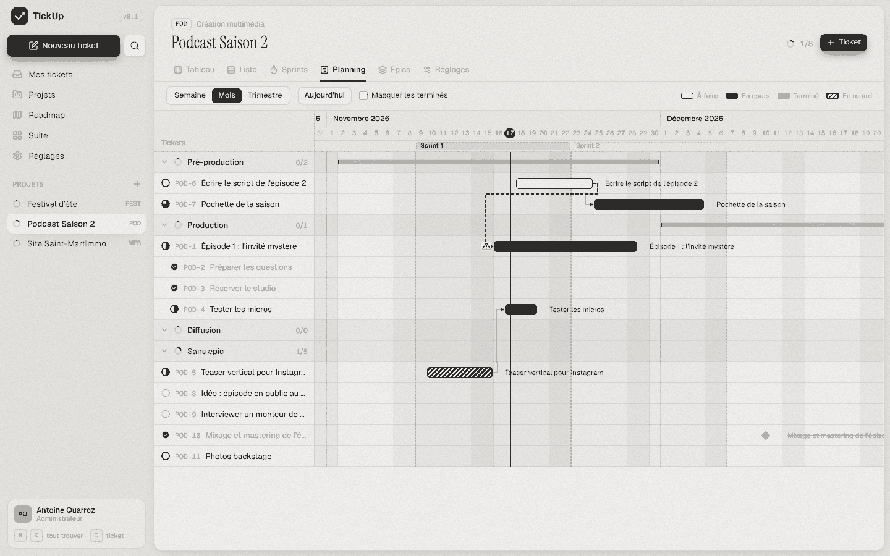
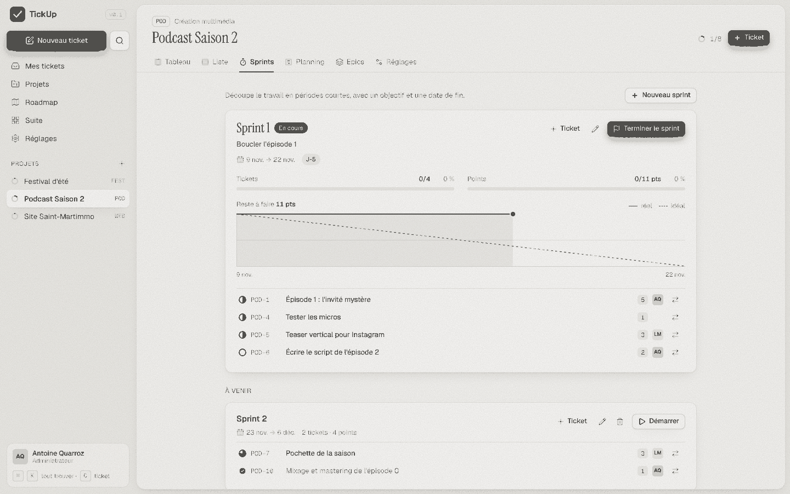
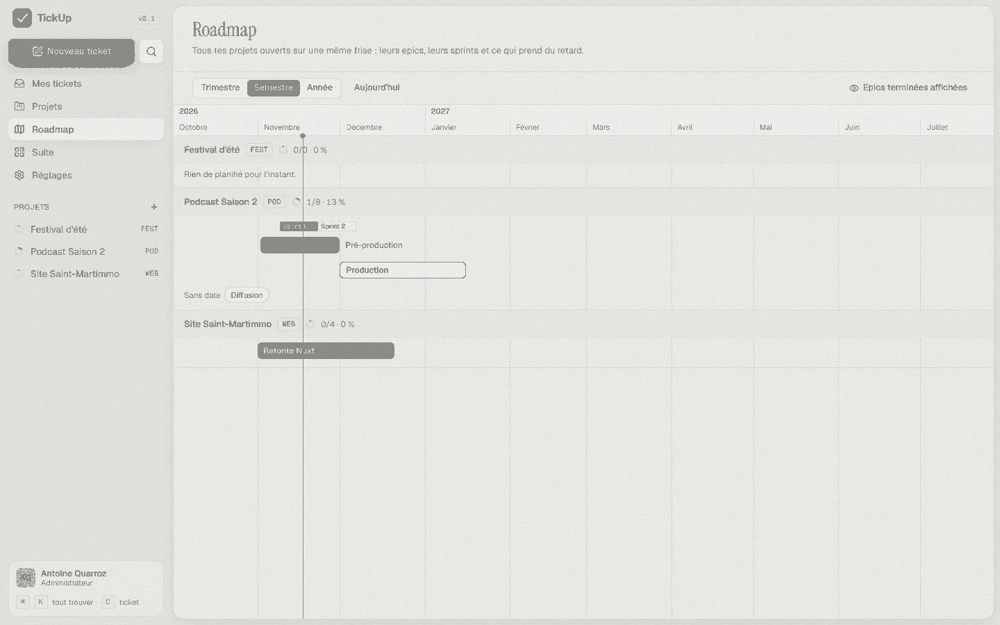

# TickUp

La gestion de projet de la suite. Projets, epics, tickets et sous-tickets, en kanban ou en liste : de quoi remplacer Linear, pour une vidéo comme pour du code.

TickUp fait partie de la même suite que [Cordée](https://github.com/antoinequarroz/maya-teams) (messagerie, la base), [Cairn](https://github.com/antoinequarroz/Cairn) (notes et coffre), [Metricove](https://github.com/antoinequarroz/metricove_v2) (réseaux sociaux) et [Alfred](https://github.com/antoinequarroz/Alfred) (calendrier) : même stack, même design, une autre couleur. Ici, le noir et blanc.






## Ce qui marche aujourd'hui

- **Trois styles de projet** : général, création multimédia, développement informatique. Chacun arrive avec ses statuts, ses types de tickets, ses étiquettes (et ses epics de départ pour le multimédia). Tout reste modifiable ensuite.
- **Tableau kanban** : une colonne par statut, glisser-déposer entre colonnes et dans une colonne.
- **Liste** : tous les tickets groupés par statut, avec les sous-tickets sous leur parent.
- **Tickets** : type, statut, priorité, responsable, étiquettes, epic, échéance, estimation, description, commentaires. Numérotés par projet (`WEB-12`).
- **Sous-tickets** : sur autant de niveaux que voulu, avec l'avancement sur le parent.
- **Epics** : les grands chantiers, avec dates de début et cible, état et avancement.
- **Sprints** : un sprint en cours par projet, avec objectif, dates, avancement en tickets et en points, courbe du reste à faire. À la fin, les tickets ouverts passent au sprint suivant ou reviennent au backlog.
- **Planning (Gantt)** : chaque ticket est une barre entre son début et son échéance, à déplacer ou étirer à la souris. Les dépendances (« bloqué par », « bloque ») sont des flèches, et un ticket qui commence avant la fin de celui qui le bloque est signalé.
- **Roadmap** : les epics et les sprints de tous les projets sur une même frise.
- **GitHub** : PR, branches et commits reliés aux tickets, ticket terminé à la fusion (voir plus bas).
- **Import depuis Linear** : équipes, statuts, étiquettes, projets, cycles, tickets et commentaires, par l'API de Linear (voir plus bas).
- **Filtres** : texte, responsable, priorité, étiquette, epic, sprint, type.
- **Mes tickets** : ce qui m'est attribué, tous projets confondus.
- **Réglages par projet** : statuts (nom, catégorie, ordre), étiquettes (cinq teintes du gris au noir), types et icônes, archivage.
- **En direct** : un changement fait ailleurs s'affiche sans recharger.
- **Clavier** : `⌘K` pour tout trouver (taper `WEB-12` ouvre le ticket), `C` pour créer un ticket.
- **Comptes** : comme dans Cordée, la première personne crée son compte et devient administratrice, puis ajoute les membres dans Réglages.
- **Clair et sombre**, installable sur Mac et iPhone.

## Lancer en local

```bash
pnpm install
pnpm dev
```

Puis ouvrir http://localhost:3000 et créer le premier compte.

```bash
pnpm test    # projets, tickets, sous-tickets, statuts, epics, dates
pnpm lint
pnpm build
```

## Brancher TickUp à la suite

Trois liens, tous réglés dans `.env` (voir `.env.example`). L'état de chacun s'affiche dans la page « Suite ».

### 1. Dans Cordée

Cordée liste TickUp dans ses modules. Il suffit de lui donner l'adresse : `TICKUP_URL=https://tickup.antoinequarroz.ch` dans le `.env` de Cordée. Dans l'autre sens, `CORDEE_URL`, `CAIRN_URL`, etc. dans le `.env` de TickUp affichent les autres outils dans sa barre de gauche.

### Les agents IA (serveur MCP)

TickUp a son propre serveur MCP à l'adresse `https://tickup.postmelo.ch/mcp` (Streamable HTTP, sans état). Claude, Alfred, Claude Code ou tout agent compatible MCP peut y lire les projets, chercher, créer, modifier, déplacer et commenter des tickets, créer des epics et des projets. Chaque agent a son propre compte (« Claude », « Alfred ») : ses tickets et ses commentaires portent son nom, et on peut lui assigner un ticket.

- **Claude (claude.ai, appli bureau et mobile)** : Réglages › Connecteurs › Ajouter un connecteur personnalisé, adresse `https://tickup.postmelo.ch/mcp`. Claude ouvre TickUp, tu te connectes, tu cliques sur « Autoriser » : la clé est créée et transmise toute seule (OAuth 2.1 avec PKCE et inscription dynamique).
- **Claude Code** : `claude mcp add --transport http tickup https://tickup.postmelo.ch/mcp` (même autorisation dans le navigateur), ou avec une clé : `--header "Authorization: Bearer tku_…"`.
- **Autres agents et scripts** : Réglages › Agents IA › « Créer la clé », puis l'en-tête `Authorization: Bearer tku_…`. La même clé ouvre aussi l'API REST ci-dessous.

Outils : `whoami`, `list_projects`, `get_project`, `list_issues`, `list_my_issues`, `get_issue`, `create_issue`, `update_issue`, `add_comment`, `link_issues`, `create_epic`, `update_epic`, `create_project`, `list_users`. Ils prennent des noms (statut « En cours » ou catégorie `done`, type, epic, étiquettes, personne ou `me`) plutôt que des identifiants. Réglages › Agents IA liste les clés, quand chacune a servi pour la dernière fois, et révoque celle qu'on veut.

### 2. L'API (les autres outils écrivent dans TickUp)

Avec `API_TOKEN` défini (ou la clé d'un agent, voir plus haut), n'importe quel outil de la suite, Hermes, Claude Code ou un script peut lire et écrire, comme pour Cairn :

```bash
# Créer un ticket
curl -X POST https://tickup.antoinequarroz.ch/api/projects/POD/issues \
  -H "Authorization: Bearer $API_TOKEN" -H "Content-Type: application/json" \
  -d '{"title": "Monter le teaser", "priority": 2}'

# Lire un ticket, ses sous-tickets et ses commentaires
curl https://tickup.antoinequarroz.ch/api/issues/POD-12 -H "Authorization: Bearer $API_TOKEN"
```

| Route | Rôle |
| --- | --- |
| `GET, POST /api/projects` | Lister, créer un projet (`name`, `key`, `template` : `general`, `media`, `software`) |
| `GET, PATCH, DELETE /api/projects/{CLÉ}` | Tout le projet : statuts, étiquettes, types, epics, tickets |
| `GET, POST /api/projects/{CLÉ}/issues` | Lister, créer un ticket (`parentId` pour un sous-ticket) |
| `GET, PATCH, DELETE /api/issues/{id ou CLÉ-12}` | Un ticket |
| `POST /api/issues/{id ou CLÉ-12}/comments` | Commenter |
| `POST /api/projects/{CLÉ}/epics`, `PATCH, DELETE /api/epics/{id}` | Epics |
| `GET /api/my-issues` | Mes tickets ouverts |
| `GET /api/notifications`, `POST /api/notifications/read` | Mes notifications ; `{ "ids": [...] }` ou `{ "all": true }` pour les marquer lues |
| `GET, PUT /api/issues/{id ou CLÉ-12}/watch` | Suivre un ticket : `{ "watching": true }` |
| `GET /api/suite` | Public : la description du module et de son API |

Le jeton agit au nom du premier compte administrateur.

### 3. Les événements (TickUp prévient les autres outils)

Avec `SUITE_WEBHOOK_URL`, chaque changement est envoyé en `POST` JSON à cette adresse :

```json
{
  "source": "tickup",
  "event": "issue.updated",
  "at": "2026-11-17T10:00:00.000Z",
  "appUrl": "https://tickup.antoinequarroz.ch",
  "data": { "issue": { "ref": "POD-12", "title": "…" }, "changed": ["statusId"], "previous": { "statusId": "…" } }
}
```

Événements : `project.created|updated|deleted`, `issue.created|updated|deleted|commented`, `epic.created|updated|deleted`. L'envoi ne bloque jamais TickUp : si l'outil d'en face est éteint, l'événement est perdu.

## Notifications

La cloche (« Notifications » dans la barre de gauche) prévient, en direct :

* quand on t'attribue un ticket ;
* quand on te mentionne dans un commentaire avec `@Prénom Nom` (ou `@Prénom` s'il est unique) ;
* quand un ticket que tu suis change de statut, GitHub compris. Le créateur et la personne assignée suivent un ticket, comme qui l'a commenté. Le bouton cloche du ticket permet de le suivre ou de ne plus le suivre ;
* la veille d'une échéance d'un ticket qui t'est attribué (dès 8 h, heure suisse).

Jamais pour ce que tu as fait toi-même, jamais pour un agent IA. Par e-mail aussi si tu le choisis dans Réglages, quand `SMTP_URL` et `MAIL_FROM` sont définis (voir `.env.example`).

## Relier GitHub

TickUp suit tes dépôts par un webhook, sans jeton ni application à installer.

1. Dans `.env` de TickUp : `GITHUB_WEBHOOK_SECRET=` suivi d'un secret (`openssl rand -hex 32`), puis redémarre.
2. Dans chaque dépôt GitHub : Settings → Webhooks → Add webhook. Payload URL `https://<ton-tickup>/api/github/webhook`, Content type `application/json`, le même secret, événements « Pull requests » et « Pushes ».

Ensuite :

- Une PR ou un commit qui nomme un ticket en majuscules (`WEB-12`, dans le titre, la description ou le message) apparaît dans le ticket, section GitHub. Une branche aussi, d'après la première référence de son nom, en minuscules si tu veux (`web-12-page-fiche-bien`). Le bouton branche du ticket copie un nom tout prêt.
- Ouvrir une PR pour un ticket le passe « en cours » s'il n'avait pas commencé.
- Fusionner la PR dans la branche par défaut termine le ticket, s'il est nommé dans le titre ou la branche de la PR, ou après un mot de fermeture dans sa description (`Fixes WEB-12`, `Closes`, `Resolves`, `Corrige`, `Ferme`). Un commit qui arrive sur la branche par défaut avec un mot de fermeture fait pareil.
- Un ticket seulement mentionné est relié, jamais déplacé. Un ticket déjà terminé n'est pas rouvert.
- Une PR venue d'un fork (quelqu'un d'extérieur au dépôt) est reliée mais ne déplace aucun ticket. Le secret vaut pour tous les projets de TickUp : ne branche que des dépôts où tu fais confiance à ceux qui peuvent pousser.

## Se connecter avec le Compte Postmelo

TickUp accepte le compte unique de la suite ([postmelo-compte](https://github.com/antoinequarroz/postmelo-compte), OpenID Connect). Dans `.env` :

```env
COMPTE_URL=https://compte.postmelo.ch
COMPTE_CLIENT_SECRET=<32 caractères au moins>
APP_URL=https://tickup.postmelo.ch
```

Côté compte : `TICKUP_URL` (la même adresse que `APP_URL`) et `TICKUP_CLIENT_SECRET` (le même secret). La page de connexion propose alors « Continuer avec mon Compte Postmelo », et « Utiliser mon mot de passe TickUp » reste en secours. Sans ces variables, rien ne change.

- La personne est retrouvée par son identifiant, sinon par son e-mail : les comptes déjà créés dans TickUp gardent leurs tickets. Une personne inconnue est créée à sa première venue, sans mot de passe TickUp.
- Le compte fait référence pour le nom, l'e-mail et le rôle. Seule exception : le dernier administrateur de TickUp le reste.
- C'est le compte qui décide qui a accès à TickUp (page Admin du compte).
- Se déconnecter de TickUp ferme aussi la session du compte.

Le code : `src/server/compte.ts` (copie de `clients/compte.ts` du dépôt du compte) et `src/app/api/auth/compte`.

## Importer depuis Linear

Dans Réglages → « Importer depuis Linear » (administrateurs). Crée une clé dans Linear → Settings → Security & access → Personal API keys, colle-la, choisis les équipes, puis « Importer ».

- Une équipe Linear devient un projet, avec la même clé : `ENG-42` reste `ENG-42`. Si la clé est déjà prise par un autre projet, une clé voisine est choisie (`ENG2`).
- Sont repris : les statuts (dans l'ordre de Linear), les étiquettes, les projets Linear (en epics), les cycles (en sprints), les tickets (titre, description, statut, priorité, estimation, échéance, responsable, sous-tickets, dates d'origine), les dépendances « bloque » et les commentaires.
- Les personnes sont reconnues par leur e-mail : crée leurs comptes avant d'importer. Les autres sont listées dans le résultat, et leurs tickets arrivent sans responsable.
- L'import se relance sans risque : seul ce qui est nouveau dans Linear s'ajoute. Ce qui a déjà été importé (repéré par `external_ref = linear:<id>`) n'est jamais dupliqué et garde les changements faits dans TickUp, sauf si tu coches « Reprendre la version de Linear ». Les tickets créés dans TickUp ne sont pas touchés. Les commentaires n'arrivent qu'à la première importation d'un ticket.
- Chaque équipe est écrite en une seule transaction : une erreur ne laisse rien à moitié importé.
- Sans clé : `POST /api/import/linear/file` (administrateur ou `API_TOKEN`) accepte un fichier JSON `{ team, issues, comments }`, les mêmes données que l'import lit dans Linear. Mêmes règles : additif par défaut, `?overwrite=1` pour reprendre la version de Linear, tout ou rien, 8 Mo au plus.
- La clé ne sert que le temps de la requête : elle n'est ni enregistrée, ni journalisée. Linear limite le nombre de requêtes par heure ; pour un très gros espace de travail, importe les équipes en plusieurs fois.

Le code : `src/server/linear.ts` (client GraphQL et correspondances), `src/server/import.ts` (écriture en base), `src/app/api/import/linear` (la route).

## Comment c'est fait

Next.js 15, React 19, Tailwind 4, SQLite (better-sqlite3), comme Cordée dont TickUp reprend le socle (comptes, sessions, thème, briques d'interface).

| Dossier | Contenu |
| --- | --- |
| `src/lib/templates.ts` | Les trois styles de projet. Pour en ajouter un, c'est ici. |
| `src/server/db.ts` | Toute la base. Le seul endroit à réécrire pour passer à PostgreSQL. |
| `src/server/suite.ts` | Les événements vers la suite. |
| `src/server/auth.ts` | Sessions par cookie, et jeton d'API. |
| `src/app/api` | L'API. Chaque route vérifie la session ou le jeton. |
| `src/app/(app)/p/[key]` | Les vues d'un projet : tableau, liste, sprints, planning, epics, réglages. |
| `src/components` | L'interface. `ui.tsx` contient les briques communes à la suite. |
| `src/app/globals.css` | Les couleurs et le thème, repris de la suite, en noir et blanc. |

## La suite

- Pièces jointes, mentions et notifications.

## Déploiement

`deploy/docker-compose.yml` lance TickUp sur le VPS derrière le Caddy déjà en place : le pas à pas est dans [docs/DEPLOIEMENT.md](docs/DEPLOIEMENT.md). Les données vivent dans le volume `tickup-data` : c'est lui qu'il faut sauvegarder.
